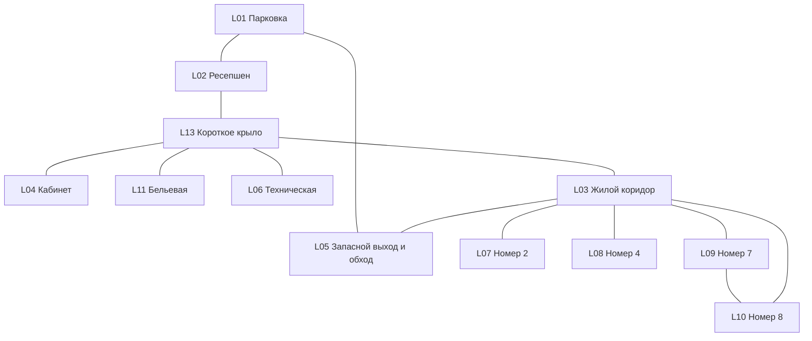
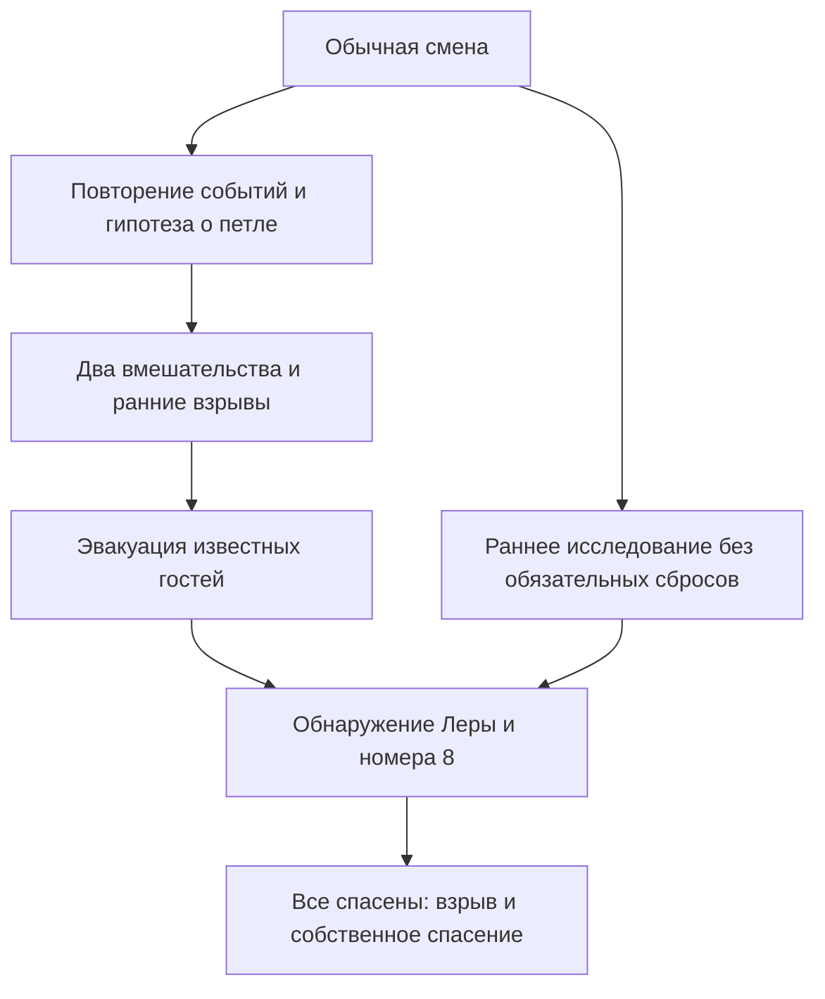
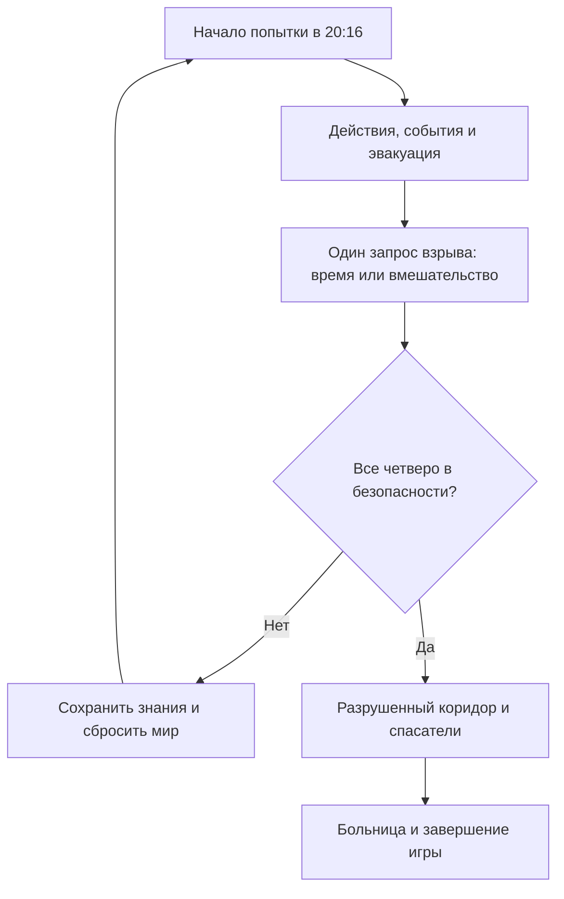

# Геймдизайн игры Мотель

**Версия 0.14 · 2 ноября 2026 года**

Рабочий геймдизайн-документ для разработки в Unity. Основа — приложенный документ «ПП_Motel_GDD_v0_1.docx», версия 0.1 от 15 октября 2026 года. В этой редакции сохранены сюжет, механики, таблицы событий, диалоги, условия и проверки; добавлены последующие решения о планировке и фактическом прототипе.

## Текущий контекст разработки

### Принятые решения на 31 октября 2026 года

- **Планировка В:** одноэтажный Г-образный мотель, два ряда номеров вдоль закрытого коридора. Номера 1–4 — с одной стороны, 5–8 — с другой. Это выбранная основа для проверки, а не окончательный архитектурный чертёж.
- **Ресепшен и службы:** короткое крыло от левого конца жилого коридора. Кабинет, бельевая и отдельная техническая открываются в общий проход. Ресепшен находится у нижнего конца короткого крыла, главный вход обращён во внутренний двор.
- **Парковка:** внутри угла здания, дорога — перед ней. Второй выход в правом конце жилого коридора соединён наружным обходом с той же парковкой.
- **Комнаты 7 и 8:** соседние, с соединительной дверью. Основная дверь восьмой помечена «Подсобка». Комната и девушка не создаются после определённого количества попыток.
- **Среда:** Unity 6.6, точная версия `6000.6.7f1`, шаблон Universal 3D, URP, C#, установленный Input System. Работающие пакеты и настройки не менять ради старых предварительных предложений.
- **Взаимодействие:** текущий прототип использует `E` и дальность до 2,5 м. Значение 2 м из раннего GDD заменено этим ориентиром; окончательная настройка зависит от проверки игры.
- **Репозиторий:** `https://github.com/rez0nex/Motel`. Постоянная рабочая ветка — `dev`; проверенные этапы сливаются в `main`, после чего работа продолжается в `dev`. Точный порядок Git-операций задаёт актуальный `AGENTS.md`.

### Что уже подтверждено

По отчёту локального Codex реализована сцена `Assets/Scenes/Prototype.unity`, её генератор `Motel → Create Prototype Scene`, управление WASD и мышью, CharacterController, гравитация, захват курсора кликом, освобождение через Escape, прицел, подсказки, проверка расстояния и препятствий, плавная дверь с коллайдером. Пользователь подтвердил работоспособность первого прототипа в Unity Play Mode. Это ручная проверка пользователем; утверждение не заменяет отдельные тесты остальных механик.

Созданы `Docs/DEVELOPMENT_LOG.md`, `Docs/TASKS.md`, `Docs/DECISIONS.md`, `AGENTS.md` и README. Пользователь сообщил об успешном сохранении и слиянии первого этапа: на момент сообщения `main` и `dev` указывали на `2cfda82`, рабочее дерево было чистым. Это историческая отметка, не гарантия текущего состояния репозитория.

30 октября 2026 года получена ручная приёмка MotelBlockout: пользователь подтвердил в Unity Play Mode исправленные таблички, управление, двери, столкновения, доступные помещения, соединение 7–8 и оба маршрута на парковку и принял текущую черновую планировку В. Это подтверждение локации, а не реализация будущих систем игры.

### Ближайшая задача и граница реализации

Первый блокинг сохранён коммитом `cae250d`, слит в main коммитом `55d55ab`. Следующее обновление той же MotelBlockout добавляет увеличенные номера, прихожую, отдельный санузел, жилую часть и поворот стойки к входу. 30 октября 2026 получена ручная приёмка пользователя в Unity: размеры номеров и размещение стойки устраивают. Мебель и сантехника остаются временными заготовками; модели, текстуры и окончательное освещение — будущие задачи. Принятый этап сохранён в `1d78f13` и слит в `5aafabe`. Дополнительная полировка остаётся за границами текущего этапа.

Предыдущий реализованный этап: шестиминутная петля (20:16–20:22, 360 секунд активного времени), единая авария и перезагрузка сцены, один объект аварийного отключения, одно наблюдение в простом окне J и девять неоткрываемых окон. Обычная скорость — 360 настоящих активных секунд, явно обозначенная отладочная — 60 секунд. Escape/потеря фокуса и окно наблюдений останавливают симуляцию; клик продолжает после паузы, J или кнопка закрытия продолжает после наблюдений. Факт «Отключение оборудования вызвало взрыв» хранится отдельно от сцены в `persistentDataPath/observations-v1.json` (версия 1). Повреждённый/неизвестный формат не перезаписывается; при ошибке сохранения окно сообщает ограничение текущей сессией. Полная ручная приёмка остаётся открытой.

Этап петли сохранён в `01bf0b8` и включён в main существующим GitHub-слиянием `8ca188e`; dev синхронизирована. Полный ручной маршрут петли не отмечен принятым.

Принятый предыдущий этап (31 октября 2026): **первый эпизод Леонида в номере 4** — пробуждение вблизи через E, текстовый диалог с выбором, предупреждение об аварии, подача трости и физический выход к месту сбора. Трость разрешено взять до разговора. Диалог блокирует движение и действия с миром, но время идёт; Escape закрывает его и ставит обычную паузу. Карточка, слуховой аппарат и полноценный инвентарь в этот эпизод не входят. Пока используется один заданный маршрут через запасной выход: закрытые двери и препятствия задерживают Леонида, после освобождения пути он продолжает сам; сопровождение по близости игрока и выбор нескольких выходов остаются будущими задачами. Спасение засчитывается только на парковке, сохраняется как наблюдение и не отменяет взрыв/сброс. Состояние NPC и переносимой трости сбрасывается со сценой. Прототип принят пользователем 31 октября 2026; окончательная полировка отложена. Подробный статус — в TASKS, маршрут — в [LEONID_EPISODE.md](LEONID_EPISODE.md).

Вадим приходит в текущую смену и **всегда сначала заселяется в №2**. Журнал предыдущего сменщика содержит №4 / Леонид / 1 и №7 / Марина / 2; проверка брони и выдача ключа — действия игрока. До первого фактически пережитого взрыва и загрузки новой попытки в диалогах Вадима нет предупреждения о будущем взрыве или эвакуации, даже после диагностики. После этого знание героя позволяет предупредить у стойки, но Вадим всё равно требует оформления. Эвакуация разрешена только после физического прибытия в №2, свежей диагностики и отдельного указания выхода. Старые наблюдения и обычный перезапуск не открывают знание о взрыве. Подробности — N01 и [VADIM_EPISODE.md](VADIM_EPISODE.md).

2 ноября 2026 пользователь принял прототип Вадима: после сброса требуется свежая диагностика, наблюдение сохраняется, осмотр до разговора работает. Окончательная полировка и весь расширенный ручной маршрут этим не подтверждаются.

Предыдущий принятый этап — **связанный эпизод Марины (№7) и Леры (№8)**. Обе находятся в комнатах с начала каждой попытки. Марина объясняет размещение, после подтверждения разделённого поиска выходит сама; Лера следует за игроком и может быть спасена первой. Ключи от №8 доступны у Марины и на стойке, проход 7 ↔ 8 сохраняется. Знание размещения и спасения каждой сохраняется отдельно от текущих состояний. Даже спасение четверых пока заканчивается обычным взрывом и сбросом.

Прототип Марины и Леры принят пользователем 2 ноября 2026 года; это приёмка текущего игрового результата, без заявления об окончательной полировке.

Текущий этап добавляет простые журнал заселения и проверку брони/выдачу ключа Вадиму через выбор действий. Полный инвентарь, книжный журнал, второе вмешательство и финал остаются вне этапа. Объём задачи задают запрос пользователя и `Docs/TASKS.md`.

### Текущий этап и следующие согласованные изменения

Лере 14 лет; возраст задан в данных персонажа. Сложное возрастное оформление временной модели и полная редактура реплик остаются будущими задачами. Леонид, Марина и Лера заселены предыдущим сменщиком: начальный журнал проживающих содержит №4 — один гость и №7 — два. Вадим приходит в текущую смену и сначала заселяется; убедить уйти можно только в №2 после пережитого взрыва и по свежей диагностике. Запасная трость Леонида находится в машине. Альтернативный проход 7 ↔ 8 в будущем закрыт передвигаемым шкафом, который можно отодвинуть. Ремонт оборудования включает короткую головоломку.

Окончательная длительность цикла определяется после добавления этих задач и игровых замеров. **360 секунд (20:16–20:22) пока временная рабочая настройка**, расписание и проверки ниже относятся к ней. В новом прототипе журнал на стойке открывается через E: только №4 Леонид / 1 и №7 Марина / 2, без №8, слуха, трости и способов спасения. Только выдача ключа после проверки брони добавляет №2 / 1 и отправляет Вадима в номер. Эвакуация у стойки и на пути к номеру отменена заданием 2 ноября. На сбросе журнал, оформление, разговоры и свежая диагностика очищаются, постоянные наблюдения и отдельное знание пережитого взрыва сохраняются. Трость пока у кровати, проход 7 ↔ 8 свободен, головоломки нет. Этап начала смены и исправленный сценарий Вадима приняты пользователем после ручной проверки 2 ноября 2026 года; окончательная полировка не заявляется.

### Порядок чтения и обновлений

1. Читать `AGENTS.md`, текущие задачи, принятые решения и последние записи журнала разработки.
2. Этот файл хранит целевой дизайн. Для конкретной задачи перечитывать соответствующие разделы.
3. Последние явные указания пользователя имеют приоритет над более ранними предварительными решениями GDD. Важные новые решения отражать и здесь, и в `Docs/DECISIONS.md`, чтобы убрать противоречия.
4. Скрин выбранной планировки дополняет пространственную схему, но не задаёт точные размеры. При недоступности изображения пользоваться текстовым описанием раздела 3 и сообщить об ограничении.
5. GDD описывает намерение, журнал разработки — выполненное, `TASKS.md` — следующий шаг. Не смешивать эти статусы.

## Навигация

- [1 Замысел и границы игры](#1-замысел-и-границы-игры)
- [2 Игровой цикл и управление](#2-игровой-цикл-и-управление)
- [3 Локация и маршруты](#3-локация-и-маршруты)
- [4 Полная история и раскрытие правды](#4-полная-история-и-раскрытие-правды)
- [5 Пример первого прохождения](#5-пример-первого-прохождения)
- [6 Схема развития знаний](#6-схема-развития-знаний)
- [7 Расписание шестиминутной попытки](#7-расписание-шестиминутной-попытки)
- [8 Вадим и Леонид](#8-вадим-и-леонид)
- [9 Марина и Лера](#9-марина-и-лера)
- [10 Механики предметов и окружения](#10-механики-предметов-и-окружения)
- [11 Журнал и документы](#11-журнал-и-документы)
- [12 Диалоги и выдача подсказок](#12-диалоги-и-выдача-подсказок)
- [13 Сброс и условие финала](#13-сброс-и-условие-финала)
- [14 Состояния и сохранение](#14-состояния-и-сохранение)
- [15 Финальная сцена](#15-финальная-сцена)
- [16 Визуал звук и интерфейс](#16-визуал-звук-и-интерфейс)
- [17 Ассеты и состав сцен](#17-ассеты-и-состав-сцен)
- [18 Предлагаемая архитектура](#18-предлагаемая-архитектура)
- [19 План разработки и готовность этапов](#19-план-разработки-и-готовность-этапов)
- [20 Проверка качества и открытые решения](#20-проверка-качества-и-открытые-решения)
- [21 Как поддерживать документ](#21-как-поддерживать-документ)

Спецификация сюжета, механик и первого прототипа

Документ задаёт поведение игры и служит основой для задач разработки. Сначала проверяется работоспособность временной петли и эвакуации, затем собираются окружение, атмосфера и финал. Игра содержит одну основную концовку; сведения о коме предназначены для разработчика и не раскрываются игроку заранее.

| Параметр | Решение |
| --- | --- |
| Жанр | Психологический триллер от первого лица с головоломками и временной петлёй |
| Сеттинг | Придорожный мотель начала нулевых, дождливый вечер |
| Визуал | Простая низкополигональная 3D графика, грубые текстуры, регулируемый VHS эффект |
| Реализация | Unity и C#, Blender для доработки моделей, Git для версий |
| Формат | Один игрок; предлагаемый первый целевой выпуск — Windows, клавиатура и мышь |
| Время цикла | 20:16–20:22, 360 секунд игрового времени; вмешательство вызывает ранний взрыв |
| Суть прогресса | Знания сохраняются между попытками, предметы и состояния мира сбрасываются |

### Как пользоваться документом

Разделы 1–7 задают замысел, сюжет и события; 8–12 — поведение гостей и механик; 13–18 — состояния, финал, интерфейс и реализацию; 19–21 — план, проверку и ведение документа. Объекты, события и требования имеют постоянные идентификаторы для обсуждения и реализации.

Обозначения: З — закреплено в обсуждении; П — предлагаемое решение для прототипа; Н — параметр требует проверки на игре. Предложение не считается уже реализованной функцией.

## 1 Замысел и границы игры

### Основное переживание

Игрок начинает обычную смену администратора. Взрыв возвращает его к началу. Он исследует оборудование, пробует два разумных способа остановки и затем переключается на эвакуацию. Проверяя гостей, обнаруживает пропущенную Леру в бывшем восьмом номере. После спасения всех взрыв впервые приводит к продолжению воспоминания: героя находят спасатели, затем он приходит в сознание в больнице.

Герой в реальности пережил взрыв и находится в коме. Мотель показывает фрагменты воспоминаний, повторений и воображаемых попыток изменить исход. Ранние ремонты — альтернативные действия внутри этого переживания. Воспоминание продолжается, когда восстановлено спасение всех людей и герой доходит до момента собственного спасения.

### Опорные решения

- Знание позволяет действовать быстрее и менять порядок задач. Обязательного количества сбросов нет.
- Здание имеет постоянную планировку. Изменения подчёркивают найденные сведения и не перемешивают комнаты.
- Взрыв всегда видим и разрушителен. Его нельзя отменить доступными действиями с оборудованием.
- Лере 14 лет; она существует с начала игры, дополнительные сведения помогают обнаружить её, а не создают персонажа.
- Напряжение создают время, расследование и ответственность за людей. Боевая система, преследователь и скримеры не входят в основу.
### Объём первого законченного выпуска

Одна связная локация мотеля и небольшая парковка; четыре эвакуируемых персонажа; владелец по телефону текстом; один короткий финал со спасателем и матерью. Желаемая длительность первого прохождения — ориентировочно 45–90 минут с учётом чтения и ошибок (Н). Это цель для тестирования, а не обещанная продолжительность.

Озвучка диалогов, открытый мир, процедурные комнаты, разрушаемая физикой архитектура, разветвлённые концовки и собственное моделирование всех объектов в первый выпуск не включаются (П). Взрыв собирается из подготовленных состояний окружения и эффектов.

## 2 Игровой цикл и управление

### Что делает игрок

Исследует комнаты и документы → формулирует гипотезу → готовит маршрут и предметы → вмешивается в событие или помогает гостю → получает обратную связь → после взрыва применяет найденное в новой попытке. Награда за неудачу — конкретное новое знание, короткий путь или более удачный порядок действий.

| Действие | Управление для прототипа | Правило |
| --- | --- | --- |
| Ходьба и обзор | WASD и мышь | Без прыжков через препятствия и без сложной физики персонажа |
| Взаимодействие | E | Подсказка на доступном объекте; дальность и видимость проверяются |
| Диалог | Мышь или цифры | Готовые варианты; варианты обозначают намерение игрока |
| Инвентарь | Tab | Предметы можно выбрать и осмотреть; время остановлено |
| Наблюдения | J | Семь независимых фактов прототипа; время и управление остановлены |
| Журнал заселения | E по журналу на стойке | Текущие размещения; время идёт, управление блокируется экраном, Escape закрывает и ставит паузу |
| Пауза | Esc; клик для продолжения | Сейчас освобождает курсор, закрывает наблюдения и останавливает симуляцию; полноценное меню — позже |
| Повторить попытку | Меню паузы | Подтверждение; мир сбрасывается, знания остаются |

### Время и прерывания

Одна минута на часах соответствует 60 секундам активной симуляции; вся попытка — 360 секунд от 20:16 до 20:22. Только для проверки F6 на паузе переключает явно помеченную скорость ×6 (цикл за 60 активных настоящих секунд); режим сохраняется между сбросами, обычная сохранённая сцена и сборка стартуют без ускорения. Наблюдения J и меню ставят симуляцию на паузу; целевые книжные страницы и инвентарь тоже будут приостанавливать время. Текущий простой журнал заселения по E использует диалоговый экран: при чтении время идёт, Escape закрывает его и включает обычную паузу. Во время обычного диалога время идёт; текст можно быстро раскрыть и выбрать ответ. Переход взрыва закрывает диалог и блокирует новые действия.

Повторно прочитанные реплики сокращаются, но необходимые варианты ответа сохраняются. Ожидание знакомого события — дополнительная функция после проверки базового цикла (П). При ускорении вызываются все положенные события и проверяется взрыв; пропускать последствия нельзя.

### Условия результата

Победа: к началу взрыва Вадим, Леонид, Марина и Лера находятся в безопасной зоне парковки. Запись галочки в журнале не заменяет физического выхода гостя. Если хотя бы один не выведен, после взрыва начинается новая попытка. Смерть в цикле и добровольный перезапуск не удаляют накопленные знания.

## 3 Локация и маршруты

### Выбранная пространственная схема

З — выбран вариант В с двумя рядами комнат. Ниже перечислена геометрия, которую нужно проверять в сером макете:

1. Длинное крыло: северный ряд 1, 2, 3, 4; южный ряд 5, 6, 7, 8. Обе последовательности идут слева направо при взгляде сверху. Между рядами — закрытый коридор.
2. Слева коридор поворачивает в короткое крыло, ведущее к ресепшену. От этого прохода отдельные двери ведут в кабинет, бельевую и техническую. Для попадания к выходу не нужно проходить через техническую или кабинет.
3. Ресепшен у нижнего конца короткого крыла: стойка, рабочее место и свободный проход сбоку. Главный вход ведёт вправо, во двор.
4. Парковка находится внутри угла здания, дорога — перед ней. Из правого конца жилого коридора запасной выход ведёт на наружную дорожку; по ней можно вернуться к парковке, не заходя в здание.
5. Между 7 и 8 сохраняется соединительная дверь. Основная дверь восьмой комнаты помечена «Подсобка». Внутри может сохраниться старая цифра 8; тележка лишь частично закрывает вход и позже отодвигается действием игрока. Для первого макета достаточно таблички и доступного проёма, без новой механики тележки.
6. Актуальный ориентир по последнему уточнению пользователя (Н): номер 5 × 6,5 м внутри, коридор около 2,4 м по осям, высота 2,8 м, основные проёмы около 1–1,2 м. Размеры проверяются по исходному CharacterController, открытым дверям и мебели; уменьшение игрока или увеличение FOV для маскировки тесноты не используется.
7. Потолки выделяются в отдельную группу для просмотра в редакторе. Передача схемы сверху не означает отсутствие потолков в игре.

Точное размещение дыма, длина маршрутов и окончательная позиция технического оборудования ещё требуют проверки. Схема не является строительной документацией.

#### Уточнение для текущего чернового макета — 30 октября 2026

Оси плана: +X вправо, +Z вверх. Последнее изображение пользователя заменяет предыдущий визуальный ориентир. Оба ряда выровнены, все восемь номеров имеют **5 × 6,5 м внутреннего пространства**, без толщины наружных стен. Вход слева ведёт в прихожую 2 × 2,3 м; справа от неё единственный санузел 2,84 × 2,3 м с дверью только из прихожей. Полная поперечная перегородка отделяет жилую часть 5 × 4,04 м; проход слева шириной 1,2 м остаётся открытым. Нижний ряд отражён по Z.

Кровать 2 × 1,6 м располагается справа у наружной стены, длинной осью по X и изголовьем вправо в обоих рядах. Слева остаётся маршрут; добавлены тумба, шкаф и стол. В восьмом шкаф перенесён вправо от входа в спальню, чтобы не перекрывать соединительную дверь на левой стене. В санузле — только макеты душа, раковины и унитаза.

Стены 0,16 м, высота 2,8 м. Коридор и служебный проход сохраняют 2,24 м между поверхностями (2,4 м по осям). Входы номеров имеют проём 1,15 м, санузлы и соединение 7–8 — 1,1 м, служебные двери/выходы — 1,5 м; высота 2,3 м. Игрок и FOV не уменьшаются ради мебели. Основные маршруты проверяются также независимой окружностью диаметром 1 м при открытых дверях. Ощущение масштаба проверяется пользователем в игре.

Стойка ресепшена обращена лицевой панелью на восток к главному входу. Администратор стоит западнее, стартовый поворот Y = 90°, с обходом северного конца стойки шириной около 1,27 м. Гостевое крыло расширено до X = 26,64 м; с ним согласованы парковка и наружный обход. Службы и два выхода сохраняют назначение.

Соединительный проём 7–8 расположен между жилыми частями на глубине 4,25 м от передней внутренней поверхности номера, за санузлами. Кровати, тумбы и шкафы не перекрывают его траекторию. Основные двери доступных номеров и двери санузлов открываются прежним взаимодействием E без ключей; 1, 3, 5, 6 закрыты со стороны коридора. Персонажи и механики эвакуации, ключей, инвентаря, тележки, дыма и петли не входят в этот макет. Место сбора — только ориентир. Размеры, запуск и проверочный маршрут описаны в [MOTEL_BLOCKOUT.md](MOTEL_BLOCKOUT.md).

Таблички блокинга — компактные физические плашки у дверей: номера и названия служб, основной вход 8 — «Подсобка». Текст учитывает стены и двери, читается только с лицевой стороны и не занимает проход. Большие пояснения ресепшена и сбора в игровом пространстве не нужны; сам ориентир сбора сохраняется. Экранная подсказка взаимодействия одна, по наведению на доступную дверь. Это уточнение представления, без изменения планировки и игровых условий.

### Идентификаторы локаций

| ID | Помещение или зона | Связность и назначение |
| --- | --- | --- |
| L01 | Парковка | Главный вход, наружный обход и место сбора четырёх гостей |
| L02 | Приёмная и ресепшен | Стойка, журнал, рабочее место; главный вход в L01 |
| L03 | Жилой коридор | Два ряда номеров; соединяет короткое крыло и запасной выход |
| L04 | Кабинет и зона персонала | Отдельная дверь из короткого крыла; прежнее обозначение «Персонал» сохранено |
| L05 | Запасной выход и наружный обход | Правый конец L03 → наружу → L01; положение уточнено относительно версии 0.1 |
| L06 | Техническая | Источник взрыва, отдельная дверь из L13; не является эвакуационным проходом |
| L07 | Номер 2 | Вадим; вход из L03 |
| L08 | Номер 4 | Леонид; вход из L03 |
| L09 | Номер 7 | Марина; вход из L03 и соединительная дверь в L10 |
| L10 | Бывший номер 8 | Лера; дверь «Подсобка» из L03 и проход в L09 |
| L11 | Бельевая | Отдельная дверь из L13 |
| L12 | Дорога | Короткий видимый участок перед парковкой, без открытого мира |
| L13 | Проход короткого крыла | Соединяет L02 с L03; даёт отдельный доступ к L04, L11 и L06 |

### Схема связности

Схема показывает переходы, а не пропорции или положение стен. Для геометрии использовать описание выше и скрин выбранного варианта В.

В здании физически существуют восемь бывших гостевых комнат, но в рабочем журнале не указывается №8; начальные записи проживающих содержат только №4 и №7. На двери восьмой — «Подсобка», а её прежнее назначение подтверждают улики и старая цифра. Для первого выпуска достаточно интерьеров 2, 4, 7 и 8; остальные двери могут быть закрыты и повторять общий модуль (П).

В планировке В запасной выход L05 расположен в правом конце жилого коридора и связан наружным обходом с парковкой. Главный выход проходит через ресепшен. Техническая L06 открывается отдельной дверью из прохода короткого крыла L13 и не перекрывает этот проход своим оборудованием. Дым не должен одновременно перекрывать все маршруты раньше взрыва. После 20:20:30 усложняется участок возле входа в номер 8, а путь 8 → 7 → коридор → доступный выход остаётся возможным (П). Точную зону дыма и доступ к запасному выходу проверить на выбранной геометрии.

Проверяемые ориентиры (Н): обычная ходьба около 3 м/с; стойка → номер 8 за 15–25 секунд; помощь Леониду с сопровождением за 40–70 секунд. Размеры подстраиваются по прототипу. Это не готовый архитектурный план.

## 4 Полная история и раскрытие правды

### Что произошло в реальности

Герой работал администратором. Неисправность служебного оборудования привела к взрыву. До него герой помог гостям выйти и вернулся за последней девушкой. Лера успела оказаться снаружи, герой остался у порога и получил тяжёлые травмы. Его нашли спасатели и доставили в больницу. Через несколько недель он начинает приходить в сознание.

### Что переживает игрок

Сознание героя возвращает последние десять минут смены. Обычные действия знакомы, но личное и травмирующее воспоминание неполно. Сначала герой принимает происходящее за реальную временную петлю. Он пытается исправить оборудование, однако это немедленно возвращает переживание к взрыву. Затем направляет усилия на спасение людей.

Список бронирований неполон как список людей: Марина забронировала размещение на двоих, а Леру временно разместили отдельно. По вещам, словам Марины, дополнительному ключу и квитанции герой находит бывший восьмой номер. Девушка присутствует там с начала игры. После спасения всех повторение впервые доходит до того, как героя самого нашли.

### Порядок раскрытия

| Фрагмент | Что понимает игрок | Что пока скрыто |
| --- | --- | --- |
| Обычная смена | Есть неисправность и бытовые поручения | Повторение, кома, собственная травма |
| Первый сброс | События уже происходили | Механизм повторения |
| Ранние взрывы | Оборудование трогать опасно; людей надо вывести | Вмешательство обрывает переживание |
| Состав бронирования | Есть четвёртый человек и восьмой номер | Кто и когда спас самого героя |
| Разрушенный коридор | Взрыв можно пережить; героя нашли | Больница подтверждается следующим эпизодом |
| Палата | Герой находился в коме и восстанавливал ночь | Финальное подтверждение судьбы Леры |

Запрещённые ранние подсказки: прямая фраза «ты в коме», видимая палата, медицинские документы героя. Допустимы короткий писк, нечёткая фраза и белая поверхность без узнаваемой обстановки. Медицинская развязка является художественным правилом истории.

## 5 Пример первого прохождения

Таблица показывает ожидаемую последовательность понимания. Номер попытки не является условием открытия двери, появления персонажа или начала финала.

| Цикл | Действия | Новая информация |
| --- | --- | --- |
| 1 | Регистрация Вадима, полотенца Марине, осмотр блока. В 20:22 — взрыв. | Планировка, гости, неисправность, время катастрофы. |
| 2 | Повтор звонка и приезда. Герой использует аварийную остановку. | Правильное вмешательство вызывает ранний взрыв. |
| 3 | Проверяет отключение из внешнего щита. Снова ранний взрыв. | Второй способ тоже не помогает. Приоритет — вывести гостей. |
| 4 | Открывает выход, включает сирену, убеждает Вадима, теряет время с Леонидом. | Леонид плохо слышит; карточка или аппарат и трость ускоряют помощь. |
| 5 | Выводит троих, сверяет людей на парковке, разговаривает с Мариной. | Двое в бронировании; Лера в номере 8; есть второй ключ и проход через 7. |
| 6 | Планирует маршрут, выводит четверых. Взрыв происходит снова. | Вместо сброса — спасатели, затем палата и пробуждение. |

### Короткий маршрут

Игрок может в первой попытке расспросить Марину, рассмотреть комплект ключей, прочитать квитанцию, заселить Вадима, помочь Леониду и вывести Леру. По уточнению сценария Вадима его эвакуация требует пережитого взрыва: полное спасение четверых до него недоступно. Других персонажей это изменение сейчас не затрагивает. При этом герой не обязан заранее произносить реплики о петле: используются доступные с начала реплики об аварии.

### Когда попытка оправдана

Проверка должна дать проверяемое новое наблюдение: другое действие с блоком, найденный способ общения, уточнённый состав гостей или новый маршрут. После правильного спасения Леры дополнительный обязательный провал не добавляется. Если тестировщик делает подряд несколько одинаковых бесполезных циклов, улучшаются подсказки и журнал.

## 6 Схема развития знаний

Реплики о прошлых попытках появляются по флагам знаний. Доступ к номерам и ключам от этих реплик не зависит. Переход к эвакуации предлагается после двух разных ранних взрывов, но игрок может начать спасение раньше.

| Улика | Где найдена | Что сообщает |
| --- | --- | --- |
| Две чашки и сумки | Номер 7 | Марина приехала не одна |
| Запись 2 чел | Журнал | Количество бронирований не равно количеству людей |
| Второй ключ | Стойка или Марина | Есть другая доступная комната |
| Квитанция 7 + 8 | Папка смены | Лера размещена отдельно |
| План и старая цифра | Персонал и конец коридора | Где находится номер 8 и соединительная дверь |

## 7 Расписание шестиминутной попытки

Все времена отсчитываются от t = 0; конец попытки — t = 360 (20:22). Расписание сжато под согласованные шесть минут. Звонок, жалоба, дым и световые предвестники остаются планом. Леонид и семья уже в комнатах; приход Вадима запускается по активному времени, эвакуацию каждого запускает игрок. События выполняются один раз за цикл и проверяют текущие состояния. Они не возвращают спасённого гостя в номер.

| ID и время | Событие по умолчанию | Условие и влияние игрока |
| --- | --- | --- |
| EV01 / 20:16 | Старт, записка, часы и начальные состояния. | t = 0. Знания восстановлены; предметы на исходных местах. |
| EV02 / 20:16:10 | Звонок владельца. | Не запускает обязательную сцену; трубку можно не брать. |
| EV03 / 20:16:10 | Начало прихода Вадима (настраиваемые 10 секунд). | Идёт через главный вход к стойке; ждёт оформления, даже если предупреждён; диагностика не заменяет заселение. Сам подход занимает дополнительное время и не означает спасение. |
| EV04 / 20:16 | Лера в №8, Марина в №7 с начала попытки. | Доступ и спасение не зависят от номера попытки, ожидания 20:18 или предварительного разговора. |
| EV05 / 20:19 | Вадим жалуется на гул. | Только если заселён и не эвакуируется; иначе пропустить. |
| EV06 / 20:19:30 | Короткий писк и помеха телевизора. | Если телевизор выключен, звук идёт из приёмника телефона (П). |
| EV07 / 20:20 | Дымка у технической двери, гул сильнее. | Не закрывает безопасную ветвь бокового выхода. |
| EV08 / 20:20:30 | Дым возле входа в номер 8. | Обычный вход в комнату ещё доступен, путь через 7 предпочтителен. |
| EV09 / 20:21 | Мигает свет, усиливаются вибрация и звук. | Предупреждает о последней минуте; не блокирует управление. |
| EV10 / 20:22 | Запрос взрыва и оценка спасения. | Не зависит от положения героя и выполненной регистрации. |
| EV11 / по действию | Остановка на панели. | После подтверждения команды немедленно запрашивает ранний взрыв. |
| EV12 / по действию | Отключение внешнего щита. | Гасит рабочую индикацию и немедленно запрашивает ранний взрыв. |

По согласованию 2 ноября Лера всегда начинает в №8; прежнее предложение возвращения со двора в 20:18 заменено. Марина не скрывает дочь; раннее спасение Леры до разговора с матерью допустимо.

## 8 Вадим и Леонид

### N01 Вадим: заселение прежде эвакуации

Вадим начинает подход через настраиваемые 10 активных секунд (20:16:10), физически проходит главный вход и ждёт у стойки. Появление не зависит от номера попытки. Всегда сначала проверка оплаченной брони и выдача ключа №2, затем физический проход в номер; прерывание не выдаёт ключ автоматически и не дублирует запись. Приход/заселение используют прежний мотор и самостоятельное однократное открытие нужной двери. Нельзя отказать в заселении или заменить его эвакуацией.

До первого завершённого взрыва **и перезапуска** герой не знает о будущем взрыве: в диалогах Вадима нет предупреждения или эвакуации ни у стойки, ни в номере. Диагностика, семь прежних наблюдений и обычная перезагрузка сцены сами по себе этого знания не дают. После взрыва у стойки доступно предупреждение, но NPC отвечает про оплаченную бронь и требует оформить номер; свежие показания здесь не предлагаются. Первый разговор каждого цикла остаётся обычным представлением, без памяти NPC о прошлом.

В №2 до пережитого взрыва Вадим спрашивает о гуле; игрок может проверить шум или вернуться к стойке. После взрыва эвакуационный разговор доступен только по завершении оформления и физическом прибытии в комнату. Если свежих показаний нет, Вадим просит проверить оборудование. Если панель уже осмотрена в этом цикле, довод доступен сразу, без обязательного предварительного разговора. После слов о перегреве Вадим спрашивает, где выход; маршрут начинается только после ответа игрока про ресепшен, главный вход и парковку. Закрытие этого разговора не запускает движение; повторный ответ не пересоздаёт маршрут.

Путь эвакуации из №2, скорость 1,7 м/с и безопасная точка (17; −18,1) сохранены; NPC ждёт дверей/препятствий. Спасение только по физическому прибытию. На сбросе Вадим снова приходит, представляется и заселяется; разговоры, ключ, регистрация, прибытие в комнату и свежая диагностика сбрасываются. Знание героя о пережитом взрыве и прежние наблюдения остаются независимыми. Финала пока нет.

| Контекст | Разрешено | Недопустимо |
| --- | --- | --- |
| До пережитого взрыва, стойка/№2 | Оформление, вопрос о шуме | Предупреждение о будущем взрыве, эвакуация, даже после панели |
| После взрыва, у стойки | Предупреждение → требование оформления | Довод диагностики, отказ от номера, эвакуация |
| После ключа, идёт в №2 | Короткое завершение/ожидание | Эвакуация до физического прибытия |
| В №2 после взрыва, без свежей панели | Предупреждение → просьба проверить оборудование | Убеждение по старой записи J |
| В №2 после взрыва, свежая панель | Довод → вопрос NPC о выходе → указание игрока → движение | Автоматический старт до указания выхода, повторный запуск маршрута |

Точные реплики и маршрут ручной проверки — [VADIM_EPISODE.md](VADIM_EPISODE.md), начало смены — [SHIFT_START.md](SHIFT_START.md).

### N02 Леонид из четвёртого номера

**Текущий первый эпизод:** пожилой Леонид спит в номере 4. Игрок сам открывает дверь и подходит: E будит его и начинает разговор. Луч до 2,5 м учитывает первую преграду; через стену разбудить нельзя. Реплика о плохом слухе объясняет близкое общение. Ясного предупреждения об аварии достаточно: Леонид согласен выйти, но просит трость. Повторный разговор сокращён по состоянию задачи; трость можно подобрать заранее. После передачи он идёт с 1,2 м/с через дверь номера и запасной выход на парковку. Игрок открывает путь; при препятствии NPC ждёт, после открытия продолжает. На безопасной точке появляется наблюдение; финал не запускается и обычный взрыв всё равно происходит.

Ниже — расширенный целевой вариант после проверки эпизода, **сейчас не реализуется**. Пожилой человек спит без слухового аппарата и не реагирует на сирену. На двери есть карточка о слабом слухе. Громкий стук запускает короткое пробуждение и открытие двери. Предлагалась задержка 5 секунд (П).

Понятное общение достигается одним из способов: показать карточку «Авария. Выходите со мной» или помочь взять слуховой аппарат с тумбы. Затем нужно подать трость возле кровати и указать выход. Леонид идёт сам с небольшой скоростью; игрок помогает дверями и выбором пути. При уходе игрока он останавливается у последней безопасной точки и остаётся доступен для продолжения.

Условия начала сопровождения: Леонид проснулся; предупреждение понятно; трость у него; выбран доступный выход. Сирена сама по себе не выполняет эти условия. Никакой отдельной шкалы здоровья и лечения нет.

## 9 Марина и Лера

### N03 Марина из седьмого номера

Марина приехала с дочерью. Она не скрывает её существование. При доставке полотенец упоминает Леру, а на прямой вопрос объясняет размещение. В седьмом одна кровать неисправна, поэтому дочь устроили в соседней бывшей комнате. Бронирование общее на двоих.

После ясного предупреждения Марина предлагает разделить поиск: она проверит двор, администратор — соседнюю комнату. Только после подтверждения игрока начинает самостоятельный выход через запасную дверь к месту сбора. Диагностика и предмет для убеждения не нужны. Если дочь уже спасена, вместо обещания поиска игрок подтверждает выход матери к ней. Марина ждёт открытия дверей и освобождения прохода.

На парковке, если Лера ещё не прибыла, Марина спрашивает «А Леру вы вывели?» в этой же попытке; увидев прибывшую дочь, реагирует на её присутствие. Если дочь уже спасена, но Марина её не видела, игрок сообщает об этом отдельной репликой. Марина не узнаёт о спасении по глобальному флагу или старому наблюдению. После выхода остаётся у места сбора, а не возвращается в здание.

Своё кольцо ключей Марина отдаёт по просьбе. Дубликат лежит на стойке: разговор не является единственным доступом. После выхода она остаётся у места сбора и не забегает обратно, создавая повторную задачу.

### N04 Лера из восьмого номера

В семейных диалогах заголовок «Говорит: …» называет NPC, тема выводится отдельно. Основной текст — речь NPC, варианты ответа — речь администратора. Лера спрашивает «А мама? Она тоже выходит?», а игрок отвечает по текущему миру: мать в №7, ещё выходит из здания, уже во дворе либо дошла до места сбора. Пока окно открыто, ответ обновляется при смене состояния; устаревший вариант не передаётся персонажу. Лера узнаёт сообщение после выбора ответа, а не произносит его от лица администратора. Разговорная память сбрасывается с циклом.

Лере 14 лет; возраст указан в данных текущего персонажа. Возрастное оформление временной модели и полная редактура отложены. Она находится в №8 с начала каждого цикла, её можно предупредить и вывести до разговора с Мариной. Рюкзак/куртка/телефон и реакция на поздний дым остаются будущим оформлением/сценарием; сейчас используются временная модель и простое предупреждение.

После предупреждения «Здесь опасно, я проведу к месту сбора» и подтверждения Лера следует за игроком. Слова о матери зависят от её текущей стадии и физического положения: в №7, ещё выходит из здания, во дворе или у места сбора. Сохранённое знание не подменяет текущее положение. Сопровождение идёт по следу игрока с CharacterController и проверкой препятствий, без телепортации. При отрыве более 8 м Лера ждёт; возвращение игрока позволяет продолжить. Закрытую дверь нужно открыть. Соединительный проход 8 ↔ 7 доступен с начала без ключа; изнутри основная дверь №8 открывается без ключей. Снаружи нужен комплект у Марины либо дубликат со стойки. Полный инвентарь не создаётся.

Скорость Марины — 1,5 м/с, Леры — 1,7 м/с; прежние скорости остальных и 360 секунд не меняются. Спасение обеих фиксируется по фактическому прибытию в свои места у общего зелёного ориентира. Ключи, двери, разговоры и сопровождение сбрасываются; знания о размещении и спасении каждой сохраняются без копий. Временный след не выбирает обход самостоятельно: игрок должен открыть/освободить путь и при необходимости вернуться к Лере. Даже после спасения четверых сейчас выполняется обычный взрыв и сброс; целевой финал ниже ещё не реализуется.

| Ситуация | Доступное решение |
| --- | --- |
| Игрок знает о Лере с начала | Пройти с ключом или через №7 в №8; вывести сразу |
| Лера в 8, ключ у Марины | Попросить комплект или взять дубликат со стойки |
| Основной коридор задымлён | Открыть соединительную дверь и пройти через 7 |
| Игрок отстал | Лера ждёт в безопасной точке; сопровождение можно продолжить |

Девушка не появляется по номеру попытки. Ключи, тележка и проход доступны с начала. Найденные улики лишь делают смысл этих объектов понятнее.

## 10 Механики предметов и окружения

| ID | Механика | Однозначное правило |
| --- | --- | --- |
| M01 | Взаимодействие | Луч из камеры на доступный объект; E вызывает подписанное действие. Закрытая дверь показывает причину отказа. |
| M02 | Инвентарь | Ключи, полотенца, карточка, аппарат и трость. Сюжетные предметы нельзя безвозвратно выбросить; крафта нет. |
| M03 | Регистрация | Выбор существующего бронирования и выдача ключа. Не нужна для эвакуации и финала. |
| M04 | Полотенца | Один короткий перенос. Открывает естественный разговор с Мариной, но все сведения доступны и без поручения. |
| M05 | Двери и ключи | Проверка подходящего ключа из инвентаря автоматически. Кольцо 7 содержит ключи 7 и 8. |
| M06 | Ремонт | Две отдельные операции EV11 и EV12. Взрыв после подтверждения, осмотр безопасен. |
| M07 | Тревога | Сирена предупреждает слышащих гостей. Не эвакуирует автоматически и не будит Леонида. |
| M08 | Сопровождение | Гость следует по доступному пути и останавливается, если путь закрыт. У безопасной зоны фиксируется спасение. |
| M09 | Тележка | Одно действие отодвигает тележку на подготовленную позицию. Повторное действие возвращает; физический толчок не нужен. |
| M10 | Соединительная дверь | Простой осмотр и открытие засова. Никакого нового шифра в последние секунды. |
| M11 | Перезапуск | Сбрасывает мир; сохраняет знания. Подтверждение в меню защищает от случайного нажатия. |
| M12 | Взрыв | Подготовленная смена окружения, эффекты и переход. Один обработчик защищает от двойного запуска. |

Текущая дальность взаимодействия первого прототипа — до 2,5 м, с проверкой препятствий. Остальные первые значения (Н): инвентарь до 8 видимых слотов, связанные ключи занимают один; движение игрока около 3 м/с, Леонида около 1,2 м/с. Не менять уже проверенные настройки контроллера только ради этих предварительных ориентиров. Числа уточняются в игре.

## 11 Журнал и документы

**Граница текущего этапа:** окно «Наблюдения» по J с прежними независимыми фактами, простой журнал проживающих на стойке через E и проверка оплаченной брони Вадима в разговоре. Журнал использует прежний диалоговый экран; при чтении время идёт, Escape закрывает его и даёт обычную паузу. Полная книжная структура, папки документов, эвакуационный список и спойлеры не добавляются.

### Структура журнала

Целевая левая страница содержит проживающих: номер, имя, число гостей, отметка заселения. Леонид, Марина и Лера заселены предыдущим сменщиком; две начальные записи — №4 Леонид 1 и №7 Марина 2. Вадим приезжает в текущую смену: запись №2 появляется среди заселённых после регистрации, эвакуация не заменяет заселение. Запись о дополнительной комнате 8 и Лере уточняется после подтверждения любым источником, исходная строка №7 сразу указывает двух гостей. Простой журнал на стойке и регистрация Вадима добавлены в текущем этапе; книжные страницы, автоматический эвакуационный список и дополнение строки про №8 пока не добавляются.

Правая страница содержит наблюдения и эвакуационный список. Статусы обновляются по событиям: «в номере», «предупреждён», «идёт к выходу», «на парковке». Отметки регистрации остаются отдельными. Для победы используется фактическое состояние гостя, а не ручная галочка.

### Начальные документы

| ID | Документ и место | Значимые сведения |
| --- | --- | --- |
| D01 | Записка на стойке | Три бронирования; поручения; шум служебного блока |
| D02 | Журнал на стойке | Марина — два человека; второй комплект ключей |
| D03 | Заявка в папке смены | Неисправность уже наблюдалась; оборудование не обслужено |
| D04 | Инструкция в технической | Две доступные аварийные операции |
| D05 | Квитанция в папке | 7 + 8; два человека; дополнительное размещение |
| D06 | Старый план | Положение восьмого и дверь 8 → 7 |
| D07 | Карточка на двери 4 | Леонид плохо слышит; нужно громко постучать |
| D08 | Письменная карточка на стойке | Авария. Выходите со мной |
| D09 | Диагностическая панель в технической, осмотр через E | Наблюдение о перегреве сохраняется; для Вадима нужны свежие показания текущего цикла, доступные с его начала |

### Записи после опытов

Целевые записи: после первого пережитого взрыва — место и фактическое время; после аварийной остановки — «Остановка сработала. Взрыв произошёл сразу»; после внешнего щита — отдельная аналогичная запись. Обе проверки не являются обязательными для эвакуации Вадима: достаточно одного завершённого взрыва с перезапуском, затем заселения в №2 и свежей диагностики. Отдельное знание взрыва не выводится из наблюдений. Ранний взрыв сам по себе не сообщает 20:22, если игрок ещё не видел штатный конец цикла.

Повторное получение факта не создаёт дубликат. Факт можно открыть несколькими способами: например, узнать Леру от матери, из бронирования с квитанцией или непосредственно встретив. Описание обновляется по мере уточнения, не переписывая уже установленное.

## 12 Диалоги и выдача подсказок

Текстовые диалоги с короткими ветками и выбором ответа. Отсутствие озвучки предусмотрено бюджетом (П). Каждая ветка хранит ID, условия показа, текст, варианты и последствия. Ключевая информация не зависит от выбора единственной точной формулировки.

| ID | Собеседник и условие | Реплика или выбор | Результат |
| --- | --- | --- | --- |
| DL01 | Владелец, звонок | «Проверь гостей и служебный блок» | Обычные поручения |
| DL02 | Владелец, был сброс | «Мы уже говорили» → «Я только что позвонил» | Подтверждение повторения |
| DL03 | Марина, полотенца | «Второе оставь здесь, Лера заберёт» | Намёк на второго гостя |
| DL04 | Марина, вопрос о дочери | «Лера живёт в соседней комнате. Нам дали восьмой» | Знание о Лере и размещении |
| DL05 | Вадим; пережит взрыв, оформлен и физически прибыл в №2 | Без свежих показаний → просьба; свежий перегрев → вопрос о выходе → ответ игрока → движение. Стойка всегда ведёт к заселению | Самостоятельный выход после указания пути |
| DL06 | Леонид, проснулся; текущий эпизод | «В служебной части авария. Нужно выйти на парковку» | Предупреждён, просит трость; карточка/аппарат — будущая версия |
| DL07 | Леонид, предупреждён; трость у игрока | «Вот ваша трость. Я открою путь к парковке» | Начать физический выход через запасную дверь |
| DL08 | Марина на парковке, Леры нет | «А Леру ты вывел?» | Уточнение пропущенного гостя |
| DL09 | Лера, предупреждение | «Я проведу к месту сбора»; положение матери проверяется по текущему миру | Начать сопровождение, допускается спасение Леры первой |
| DL10 | Герой, обе проверки сделаны | «Как только вмешиваюсь — всё начинается. Сначала люди» | Предложить план эвакуации |

### Подсказка после застоя

Предлагаемый первый вариант (П): по запросу в журнале показывать одну подсказку к ближайшей неизвестной проблеме. Если Леонид не выходит — напомнить карточку на двери; если три бронирования проверены — предложить сверить число гостей. Автоматически сообщать ответ про Леру по номеру попытки нельзя.

Эти десять строк — минимальный набор узлов контента. Проходить все ветки не обязательно. Нейтральные приветствия, окончания и повторные ответы добавляются в тот же реестр при наполнении сцены. Разговоры, которые не дают действия или факта, сокращаются.

## 13 Сброс и условие финала

На первом запросе взрыва создаётся снимок множества спасённых гостей. Запросы от таймера и ремонта сходятся в один обработчик; повторные игнорируются. Победа проверяется до удаления NPC и смены сцены. Четыре состояния «в безопасности» ведут в продолжение воспоминания независимо от изученных документов и числа циклов.

Если игрок уже вывел всех и затем вмешался в оборудование, ранний взрыв тоже ведёт к финалу (П): ключевым является спасение, а не выбранная причина взрыва. Положение героя на парковке не отменяет финал: после вспышки показывается восстановленное воспоминание о его травме в коридоре.

## 14 Состояния и сохранение

Технические имена ниже — предлагаемый контракт для реализации. Разделение двух наборов данных обязательно: постоянные знания игрока и состояние текущего мира.

| Данные | Живут между циклами | Назначение |
| --- | --- | --- |
| SeenScheduledExplosion | Да | Игрок пережил взрыв в 20:22; можно назвать точное время |
| HasExperiencedExplosion | Да | Завершён любой взрыв и загружена новая попытка; доступно предупреждение Вадима. Не означает знание точного времени 20:22 |
| TriedPanelStop | Да | Остановка панели проверена |
| TriedExternalCutoff | Да | Проверено отключение щита |
| KnowsLeonidNeedsHelp | Да | Понятна особенность Леонида |
| KnowsLera / KnowsRoom8 | Да | Дочь и размещение обнаружены |
| ReadDocuments / Facts | Да | Множества прочитанных документов и уточнённых фактов |
| DiscoveredEvents | Да | Известные события для короткого ожидания |
| CycleIndex | Да | Номер для статистики; не открывает обязательный контент |
| elapsedTime | Нет | От 0 до 360 секунд; при старте 0 |
| EquipmentInspectedThisCycle | Нет | Только свежая диагностика текущего цикла; старый факт J не заменяет её |
| Vadim check-in / room arrival / dialogue | Нет | Бронь, ключ, физическое прибытие в №2 и разговоры должны произойти заново |
| GuestState[4] | Нет | Положение, предупреждение, сопровождение, спасение |
| Inventory / ItemOwners | Нет | Предметы у игрока, NPC или в исходных точках |
| Doors / Alarm / Cart | Нет | Замки, открытость, сирена, положение тележки |
| FiredEvents | Нет | Выполненные события этого цикла |
| ExplosionRequested | Нет | Защита от повторного перехода |
| EndingCompleted | Да | Игра завершена; повтор доступен из меню |

Сохранение создаётся после нового факта, при сбросе и завершении игры. Загрузка продолжает с 20:16, сохраняя знания; весь NPC маршрут посреди цикла не сериализуется (П). Это явно написано в меню. SaveVersion позволяет позднее менять формат. Операция записи атомарна; повреждённое сохранение не должно ломать запуск.

В текущей реализации JSON версии 1 содержит семь независимых флагов наблюдений: `cutoffCausedExplosion`, `leonidRescued`, `equipmentOverheatInspected`, `vadimRescued`, `familyPlacementKnown`, `marinaRescued`, `leraRescued`. Отдельное необязательное поле `experiencedExplosion` хранит знание пережитого взрыва вне списка J. В старом файле оно false; прежние факты его не выводят. Новые записи сохраняют все прежние поля. Флаг устанавливается только новой сценой после завершённой постановки аварии; обычный reload и диагностика его не меняют. Свежая проверка панели, журнал, бронь/ключ/разговоры и прибытие Вадима в №2 принадлежат текущему миру и сбрасываются. JSON не сериализует позиции NPC и не считает прошлые спасения текущими.

Порядок сброса: сохранить знания → остановить события и диалоги → удалить временные объекты → восстановить исходный мир и инвентарь → применить знания и атмосферу → t = 0 → разрешить управление. Сброс не дублирует NPC, ключи, подписки или звуки.

## 15 Финальная сцена

### FIN01 Разрушенный коридор

Сразу после спасения четверых при взрыве: вспышка, удар, белый экран и звон. Ожидаемой стойки нет. Герой лежит на боку среди пыли и подготовленных обломков. Ограничен обзор, движение заблокировано. Разрушенный вариант сцены используется впервые на более длительное время.

Марина снаружи: «Он остался внутри!»

Спасатель: «Здесь человек! Живой!»

Входят спасатели; проход сначала делают доступным, затем к герою подходит фельдшер. Для первого выпуска достаточно одного видимого спасателя, второго силуэта и текста фельдшера (П). Сложная толпа и симуляция спасательных работ не требуются.

Спасатель: «Смотри на меня. Не закрывай глаза. Слышишь?»

Лицо и свет на секунду соединяются с прежними неясными образами. Короткие кадры: подъём, перенос, свет над лицом, закрывающиеся двери. Это продолжение памяти, а не новая задача на спасение людей.

### FIN02 Палата

Белый потолок. Теперь источник писка виден. Рядом мать героя. Короткие переходы показывают её в разные дни, чтобы отделить недели реального времени от шести минут мотеля. Подходящий врач может оставаться за кадром (П).

Мать: «Ты меня слышишь? Ты в больнице. После того взрыва. Уже несколько недель».

Врач: «Есть реакция. После комы он начинает приходить в сознание».

Игрок смотрит на мать и нажимает простое действие «Сжать руку». Нет таймера, проверки скорости и возможности случайно проиграть финал. После затемнения мать говорит: «Та девушка приходила. Вместе с мамой. Они хотели тебя поблагодарить». На столике короткая открытка Марины и Леры. Часы показывают другое время и продолжают идти. Титры.

### Условия постановки

Финал подтверждает реальность спасённых людей. Медицинская развязка раскрывается только здесь. Игрок, который догадался раньше, всё равно получает новое событие — собственное спасение и подтверждение судьбы Леры. Длительность ориентировочно 2–4 минуты (Н).

## 16 Визуал звук и интерфейс

### Визуальные ограничения

Окружение начала нулевых: простые деревянные столы, потёртый ковролин, бежевый телефон, старый телевизор, цифровые часы, лампы тёплого света. Мебель строится из простых форм; мелкие детали переносятся в текстуры. Рисованные концепты — ориентиры композиции, а не требование повторить каждую деталь.

Материалы матовые, ограниченное число повторяемых текстур. Внешняя парковка небольшая: один автомобиль, вывеска, несколько источников света, дождь. Рельефный декор, сложные отражения и подробные автомобили не обязательны. VHS эффект регулируется и выключается. Он не должен мешать чтению журнала и диалога.

### Звук

Постоянный дождь, шаги, телефон, работа блока, сирена, дверь, часы и взрыв. Громкость эффектов и интерфейса настраивается. Взрыв предупреждается визуально и звуком, а не внезапным скачком громкости. Писк реальности сначала можно принять за неисправный прибор, затем он становится узнаваемым в палате.

### Интерфейс

- В обычной игре — небольшая точка и подсказка E рядом с доступным предметом. Указание причины отказа: «Нужен ключ» или «Сначала разбудить».
- Диалог — имя, короткая реплика, до трёх вариантов одновременно; текущий вариант выделен. Субтитры достаточно крупные, текст не скрывается мгновенно.
- Журнал открывается крупно и фронтально. Данные бронирования отделены от состояния эвакуации. Статус не передаётся одним цветом.
- Постоянного обратного отсчёта в начале нет. Время видно на часах; после обнаружения катастрофы оно записано в журнале.
- Меню: продолжить, начать новую игру, настройки, повторить попытку, выйти. Новая игра предупреждает об удалении прогресса.
Для слабого слуха и зрения важные звуки имеют подписи или визуальные подтверждения. Нужны чувствительность мыши, размер текста, громкость, выключение тряски и интенсивность VHS (П). Полная перенастройка клавиш и дополнительные платформы — после первого выпуска.

## 17 Ассеты и состав сцен

| Группа | Минимальный набор | План |
| --- | --- | --- |
| Архитектура | Модули стен, пола, потолка; повторяемая дверь; окна; стойка; 4 интерьера | P0 |
| Обязательные предметы | Журнал, телефон, часы, ключи 7/8, выхода и блока, карточка, аппарат, трость | P0 |
| Обслуживание | Полотенца, тележка, таблички, папка, квитанция, план | P0 |
| Техническая часть | Условный блок, панель, внешний щит, индикаторы | P0 |
| Четыре гостя | Вадим, Леонид, Марина, Лера; базовые стойка, ходьба, поворот | P0 |
| Разрушение | Подготовленная повреждённая дверь, 5–10 обломков, пыль, свет, звук | P0 |
| Финал | Упрощённый спасатель, мать, кровать, прибор, потолок палаты | P0 |
| Атмосфера | Дождь, одна машина, вывеска, светильники, ткань и ковролин | P1 |
| Дополнительный декор | Картины, мелкая посуда, бумаги, дополнительные пустые номера | P2 |

### Правила подбора

P0 — необходимо для прохождения; P1 — атмосфера после проверки механик; P2 — дополнительный декор.

Сначала проверить готовые бесплатные ассеты и их лицензии, затем собрать простые недостающие формы. Наличие бесплатной цены не означает разрешение на любое использование. Для каждого выбранного ассета сохранить URL, автора, условия, требование указания автора и изменения. Конкретные пакеты ещё не выбраны; документ не заявляет, что они уже скачаны.

### Организация сцен

Предлагается одна игровая сцена Motel с исходными состояниями объектов и отдельная сцена Ending с разрушенным коридором и палатой. Главное меню может быть отдельной сценой или экраном загрузки. Общие материалы, префабы дверей и идентификаторы гостей переиспользуются.

Первый прототип собирается из примитивов и временных персонажей. Декоративные ассеты не должны задерживать проверку полного цикла. Отдельные сложные анимации посадки, переноски и лицевой речи заменяются простыми подготовленными состояниями.

## 18 Предлагаемая архитектура

Это стартовая техническая схема (П), а не требование строить большой фреймворк. Для текущего проекта уже выбраны Unity `6000.6.7f1`, шаблон Universal 3D, URP, C# и установленный Input System. Blender предусмотрен для доработки моделей, Git и GitHub — для истории проекта. Выбранные пакеты и версию сохранять; будущие бесплатные ассеты проверять на совместимость с URP.

| Компонент | Ответственность |
| --- | --- |
| LoopController | Таймер, запрос взрыва, снимок спасения, единый переход |
| EventScheduler | События EV по времени; проверка условий, защита от повторного исполнения |
| KnowledgeStore | Постоянные факты и выбор доступных уточняющих реплик |
| WorldResetter | Восстановление объектов и NPC без накопления копий |
| GuestController | Локальные состояния гостя, маршрут, сопровождение, зона безопасности |
| Interaction и Inventory | Доступность действия, ключи, предметы, подсказки |
| Dialogue и Journal | Текст, варианты, последствия, отображение знаний и статусов |
| SaveService | Версия формата, атомарная запись и загрузка знаний |
| Atmosphere и Ending | Эффекты по открытиям, подготовленный взрыв и финальная сцена |

### Содержимое данных события

EventId; TriggerTime или ActionId; Conditions; Effects; OncePerCycle. Диалог: NodeId; SpeakerId; Text; Choices; Conditions; Effects. Гость: GuestId; StartPosition; State; TargetExit; SafeZoneId. Эти поля позволяют менять содержание без поиска условий в случайных скриптах.

### Порядок разработки и проверки

Сначала один гость проходит состояния и достигает безопасной зоны. Затем таймер и раннее вмешательство проходят через один обработчик. После устойчивого сброса добавляются знания, журнал и оставшиеся три гостя. Для отладки нужны видимые elapsedTime, состояния гостей, список фактов и команды вызвать взрыв, открыть факт, сбросить цикл. Отладка не входит в выпускной интерфейс.

## 19 План разработки и готовность этапов

Оценки ниже — предварительный бюджет для небольшой игры (Н). Они не учитывают неизвестный фактический опыт Unity, доступность моделей и конкретный срок сдачи. Их нужно уточнить после первого прототипа. При 15 часах в неделю 150 часов — около 10 недель; при 20 часах — около 7,5 недели.

| Этап | Часы | Проверяемый результат |
| --- | --- | --- |
| T01 Основа локации | 10 | Можно пройти от стойки к 4 и 8, открыть боковой выход |
| T02 Петля и сброс | 18 | 360 секунд, отладочные 60 секунд, единый сброс и одно сохраняемое наблюдение; второй ранний способ — позже |
| T03 Гости и эвакуация | 20 | Все четыре гостя достигают зоны; есть ранний и поздний маршрут |
| T04 Улики и диалоги | 20 | Сведения можно найти разными путями; нет обязательных повторов |
| T05 Журнал и сохранения | 14 | Факты сохраняются, статусы верны, загрузка начинает 20:16 |
| T06 Финал | 12 | Все спасены → разрушенный коридор → палата → титры |
| T07 Ассеты и атмосфера | 16 | Согласованный простой стиль, читаемые эффекты, реестр лицензий |
| T08 Проверка и сборка | 10 | Пройдены критические сценарии, сборка запускается отдельно |
| Резерв | 30 | Исправления маршрутов, совместимости, темпа и найденных ошибок |

### Первая проверяемая версия

Первый демонстрируемый фрагмент: приёмная, один коридор, выход, временный Леонид, карточка и трость; таймер, взрыв, сброс и одна сохраняемая запись. На него выделяется первый короткий рабочий этап, после которого переоценивается остальной план. Реалистичность полного объёма определяется этим результатом, а не количеством страниц документа.

### Если бюджет не сходится

Сначала сокращаются дополнительные пустые номера, декор, сложные жесты, ожидание событий и анимации финала. Сохраняются четыре гостя, знание о Лере, два наблюдаемых вмешательства, один взрыв и переход после успешного спасения. Если и это не укладывается, согласуется уменьшение объёма до одной демонстрационной петли с журналом; такой результат не выдаётся за полную игру.

## 20 Проверка качества и открытые решения

| ID | Проверка | Критерий |
| --- | --- | --- |
| QA01 | Штатный конец | При t = 360 (20:22), в обычном режиме за 360 активных секунд, в отладочном за 60 — ровно одна авария и перезагрузка |
| QA02 | Каждое вмешательство | Ранний взрыв после видимого подтверждения команды |
| QA03 | Одновременные триггеры | Таймер и ремонт не создают два перехода |
| QA04 | Все варианты спасения | Из 16 наборов спасённых NPC только полный набор ведёт в финал |
| QA05 | Спасение с первого цикла | Не требуются CycleIndex, документы или ранние взрывы |
| QA06 | Лера раньше разговора | Дверь и ключ доступны; девушка не исчезает |
| QA07 | Вадим до/после первого взрыва | До него нет предупреждения/эвакуации даже со свежей диагностикой; после — стойка требует оформления, эвакуация только после прибытия в №2 |
| QA08 | Два способа помочь Леониду | Карточка и аппарат оба позволяют начать помощь |
| QA09 | Порядок эвакуации | Оба порядка, ранняя и поздняя Лера, позволяют завершить игру |
| QA10 | Пауза и чтение | Escape и J останавливают часы, двери и симуляцию; клик / закрытие J продолжает; будущие NPC также подчиняются паузе |
| QA11 | Сохранение и загрузка | Один факт об отключении без копий между попытками и запусками; версия JSON 1; часы, двери, игрок, свет и оборудование возвращаются к началу |
| QA12 | Десять сбросов | Нет дубликатов гостей, ключей, сирен и подписок |
| QA13 | Игрок на парковке | Видимое разрушение; неполный состав даёт сброс |
| QA14 | Финал из любой позиции | Полный состав ведёт к воспоминанию, в том числе при раннем взрыве |
| QA15 | Читаемость и темп | Журнал читается с VHS; новая задача понятна без объяснения автора |

### Что проверить до наполнения окружения

Открытые решения (Н): темп шести минут; размеры маршрутов; точная зона дыма; положение Леры в первые две минуты; удобство ограниченного инвентаря; время диалога при отсутствии озвучки; стоимость финальной сцены. Все проверяются на простом прототипе. Основной риск истории — ощущение, что правильный ремонт наказан произвольно; снижается ясной обратной связью и быстрым переходом к спасению.

## 21 Как поддерживать документ

### Рабочий порядок

GDD хранится рядом с проектом и обновляется при изменении поведения. Для каждого изменения записываются версия, дата, затронутые ID, причина и влияние на уже выполненные задачи. Перед реализацией функции формулируется критерий готовности. После изменения условий обновляются схема, таблица событий и связанные проверки.

Практичный комплект для этого проекта: данный GDD; реестр задач T; таблица событий EV; реестр диалогов DL; таблица ассетов с лицензиями. Эти сущности могут сначала жить в одном документе. При росте реплик они выносятся в отдельные данные, сохраняя ID. Документ описывает ожидаемое поведение, а сборка подтверждает, что оно работает.

### Приоритет ближайшего шага

Собрать связный серый макет и проверить один цикл с одним гостем. Затем проверить первое прохождение без знания о взрыве и спасение полного состава в следующей попытке с этим знанием и новой диагностикой. До этих проверок не расширять сюжет и не заказывать сложные модели.

### Источники подхода к документации

Unity Game Design Document Template. Использован как ориентир структуры: концепция, механики, управление и схема взаимодействий. Это пример, а не обязательный стандарт индустрии. Дата обращения 25 октября 2026 года.

https://connect-prd-cdn.unity.com/20201215/83f3733d-3146-42de-8a69-f461d6662eb1/Game-Design-Document-Template.pdf

inkle — ink и Inky. Пример отдельного инструмента для написания и проверки ветвящихся диалогов; подключение к нашей игре не требуется для первого прототипа. Дата обращения 25 октября 2026 года.

https://www.inklestudios.com/ink/

### История версий

| Версия | Дата | Изменения |
| --- | --- | --- |
| 0.1 | 15 октября 2026 | Сюжет сведён с состояниями, событиями, схемами, объёмом и проверками. Уточнения для прототипа отмечены П и Н. |
| 0.2 | 30 октября 2026 | Полный перенос в Markdown; схемы Mermaid; выбран вариант В; обновлены маршруты L05 и L13, Unity/URP, дальность взаимодействия и подтверждённый статус первого прототипа. Сюжет и условия прохождения сохранены. |
| 0.3 | 30 октября 2026 | Уточнены геометрия варианта В для блокинга L01–L13 и границы текущего этапа T01. Добавлены размеры и размещение соединительной двери; ручная приёмка новой сцены ещё требуется. Сюжет и будущие механики не изменены. |
| 0.4 | 30 октября 2026 | Уточнено представление табличек блокинга: компактный физический размер, перекрытие стенами/дверями и отсутствие зеркального текста сзади. Планировка и механики не изменены; повторная приёмка в Play Mode требуется. |
| 0.5 | 30 октября 2026 | По последнему изображению и уточнению пользователя номера увеличены до 5 × 6,5 м внутри: прихожая, один санузел и жилая часть. Уточнены реальная мебель, соединение 7–8, стойка лицом ко входу и маршрут проверки масштаба. Новые механики не добавляются; новая версия ждёт Play Mode. |
| 0.6 | 30 октября 2026 | По запросу пользователя цикл сокращён до 20:16–20:22 (360 активных секунд), добавлен явный режим проверки за 60 секунд; обновлены EV05–EV10 и QA01/10/11. Граница этапа: авария/сброс, одно наблюдение J и девять окон, без NPC и остальных будущих систем. |
| 0.7 | 31 октября 2026 | Согласован первый эпизод N02/DL06–07: близкое пробуждение, прямое предупреждение без карточки/аппарата, перенос одной трости, один физический маршрут к парковке и отдельное сохраняемое знание о спасении. Остальные гости, инвентарь и финал отложены; игровая приёмка эпизода ещё требуется. |
| 0.8 | 31 октября 2026 | Уточнены N01/DL05: для Вадима нужен конкретный довод — осмотр диагностики, доступный в первом цикле без предмета/ожидания. В прототипе уже заселён с t = 0, целевой приезд/регистрация сохранены как будущие события. Добавлены независимые знания, разные пути/точки сбора двух гостей и продолжение движения второго гостя во время разговора. |
| 0.9 | 31 октября 2026 | Постоянное наблюдение о перегреве отделено от свежей проверки панели. После сброса Вадим забывает разговоры и согласие; осмотр требуется в каждой попытке, до или после первого разговора. |
| 0.10 | 2 ноября 2026 | Согласован эпизод Марины и Леры: старт в №7/8, разделение поиска с подтверждением, ключи двумя способами и свободный соединительный проход, сопровождение с учётом реального положения матери. Добавлены отдельные знания; даже спасение четверых пока не открывает финал и заканчивается сбросом. |
| 0.11 | 2 ноября 2026 | Уточнены владельцы реплик и отдельные поля имени/темы; сведения о матери сообщает администратор, Марина узнаёт о спасении дочери из сообщения или непосредственного наблюдения. Добавлены текущая разговорная память и обновление ответа при движении Марины. |
| 0.14 | 2 ноября 2026 | По новому запросу Вадим всегда сначала заселяется. Независимое знание после завершённого взрыва и перезапуска открывает предупреждение; эвакуация только из №2, по свежим показаниям и после указания выхода. Стойка и путь к номеру исключены. |
| 0.13 | 2 ноября 2026 | Начало смены: журнал предыдущего сменщика, настраиваемый приход и регистрация Вадима; данные Леры 14. Первоначальная альтернатива у стойки отменена в 0.14; приёмка нового этапа ожидается. |
| 0.12 | 2 ноября 2026 | Принят семейный прототип; зафиксирован будущий объём: Лере 14, прежнее заселение Леонида/семьи и две начальные записи журнала, приход/регистрация Вадима, запасная трость в машине, шкаф в проходе, головоломка ремонта. 360 секунд отмечены временной настройкой до следующих игровых замеров. Реализация будущих задач не начата. |

Увеличенные номера с внутренней планировкой и новый поворот ресепшена приняты пользователем после ручной проверки в Unity. Оформление примитивами временное; модели, текстуры и окончательное освещение выполняются в будущем отдельными задачами. Целевые механики GDD не начинают реализовываться автоматически. Менять статусы реализации только по фактическим результатам.
